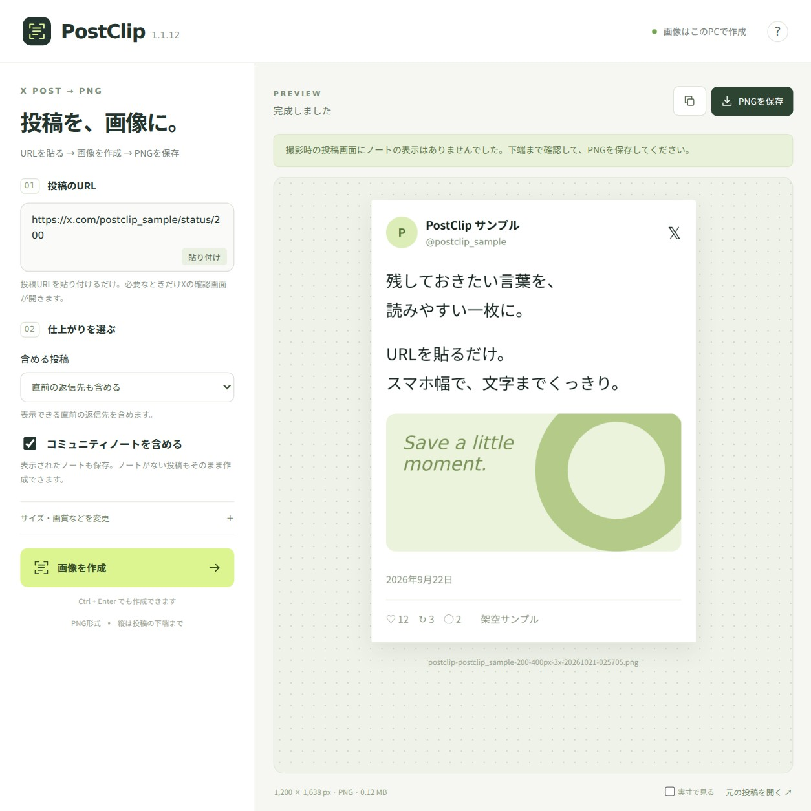

# PostClip 1.1.13



## 機能概要

Xの投稿URLを貼り付けて、スマホ幅の読みやすいPNG画像にするWindowsアプリです。本文・返信先・引用を展開し、添付されたGrok回答も全文を取得して一枚にまとめます。

### 主な機能

- 日本語GUI。URLを貼って「画像を作成」→プレビュー→「PNGを保存」
- 表示幅320〜550px、解像度1倍・2倍・3倍。文字を指定倍率で描画
- 編集済み投稿、長文、画像・引用を含む投稿に対応
- 本文・返信先・引用の「さらに表示」を自動展開。Grokの質問・回答も末尾まで取得
- URLを持たないクリック型の省略引用も、引用元を開いて本文を照合して取得
- 全文を表示した引用は、撮影幅に合わせて折り返し、末尾まで保存
- 複数往復のGrok共有会話から、カードに対応する質問・回答を取得
- アプリ内X画面のGrok「さらに表示」から、その場で全文を取得・表示
- 省略を解消できないときは、途中までの画像を完成扱いにせずエラーで案内
- この投稿のみ／直前の返信先／一番上の親までを選択（公開投稿・最大20件）
- コミュニティノート付き保存。初期設定でオン、オフにもできる
- ログインや表示確認が必要な場合だけX画面を開き、本文が表示されたら自動で続行
- 完成画像のPNG保存、クリップボードへのコピー、実寸プレビュー
- 幅・画質などの設定保存。APIキー不要、透かし・機能制限なし

### 一言で言うと

「Xの投稿を、読みやすい一枚に残すツール」

## 使い方

1. **アプリを起動する**

   `postclip-win-x64-v1.1.13.zip` を「すべて展開」して、`PostClip/PostClip.exe` を開きます。PythonやNode.jsの追加インストールは不要です。EXEだけ抜き出さず、同じフォルダーのファイルも一緒に置いてください。

2. **投稿URLを貼り付ける**

   `x.com` または `twitter.com` の `/status/` を含むURLを入力します。「貼り付け」ボタンも使えます。

3. **必要な設定だけ変える**

   「含める投稿」と「コミュニティノートを含める」を選びます。サイズや画質は「サイズ・画質などを変更」の中にあります。通常は取得方法を選ぶ必要はありません。

4. **画像を作成してプレビューを確認**

   「画像を作成」を押します。`Ctrl + Enter` でもOKです。Xの確認画面が開いた場合は、その画面で必要なログインや本文の表示を行うと自動で作成を続けます。待機中もキャンセルできます。

   本文・引用・Grok回答の全文取得が終わるまで待ちます。作成後はプレビューを確認してください。開いているX画面を使う場合は、その画面のGrokカードも全文表示に変わります。手動でGrokの「さらに表示」を押しても全文を取得でき、失敗時はカード内に理由が表示されます。エラー時は案内の下の「Xを開いて再試行」で表示確認からやり直せます。

5. **PNGを保存する**

   「PNGを保存」で保存先を選びます。「コピー」なら対応アプリに `Ctrl + V` で貼り付けられます。

## おすすめ設定例

| 用途 | 表示幅 | 解像度 | 含める投稿 |
| --- | --- | --- | --- |
| 一般的な投稿 | 400px | 3倍（横1,200px） | この投稿のみ |
| 少し幅を広くしたい | 430px | 3倍（横1,290px） | この投稿のみ |
| とても長い投稿 | 400px | 2倍 | この投稿のみ |
| 返信の流れも残したい | 400px | 2倍 | 一番上の親まで含める |

標準は400px・3倍・直前の返信先あり・ノートありです。外側の余白は0／16／24px。投稿画面の色はX側の設定を使います。「公式埋め込み」を明示的に選んだ場合だけ、ライト／ダークを選べます。

## 必要環境

- Windows 10 / 11、64bit（x64）
- インターネット接続
- アプリの展開先に約400MBの空き容量と、画像作成用のメモリー

Windows版には実行に必要なElectron / Chromiumを同梱しています。macOS・Linux・Windows ARM64用のネイティブ版は含みません。EXEは未署名です。

ソースから開発する場合はNode.js 22.12以上とnpmが必要です。依存関係はpackage-lock.jsonで固定しています。

開発中にアプリを起動する場合：

```bash
npm ci
npm start
```

Windows x64用のEXEと配布ZIPを作る場合は、ソースの最上位にある **`build-postclip.cmd`** を実行してください。Node.jsとnpmを使って、依存関係のインストール、単体テスト、Windows版のビルド、ZIP作成まで順番に行います。初回はElectronのダウンロードが必要です。

完成するファイルは `dist/postclip-win-x64-v1.1.13.zip` です。ZIPの中は `PostClip/PostClip.exe` と実行に必要な一式になっています。**BOOTH用ファイルや開発ドキュメントは含みません。** エラーが出た場合は途中のZIPを完成品として使わないでください。

## 表示・保存について

- Xの本文が表示されない投稿は撮影できません。削除・非公開・閲覧制限・Xの仕様変更などの影響を受けます。
- 同じ投稿をPostClip内のX画面で開いていれば、その表示を再読込せず使います（一番上の親までの設定でも、指定した投稿の表示を利用）。普段のブラウザーとはログイン状態を共有しません。
- Xのログインはアプリ内の通常のログインフォームを使います。Google / Appleなど外部サイト経由のログインには対応していません。
- 親までの取得は公開埋め込みで返信先を確認します。途中の親を取得できない場合は、一部だけを完成扱いにせず停止します。返信一覧や別枝の投稿は含みません。
- 本文・返信先・引用は「さらに表示」を展開して保存します。展開できない、省略や切れが残る場合はPNGを作成しません。
- Grokカードは共有ページから質問と回答の全文を取得し、「Grokによる回答 · 全文」として表示・保存します。リンクが見えない場合はカード自身の描画データも調べ、見つからなければ同じ投稿の公開表示を確認します。共有回答は公開表示を優先して読み、利用できなければ元のログイン状態で再試行します。複数の質問・回答がある場合はカードと一致する組を選び、カード情報のないリンクのみの投稿では最後の組を取得します。共有先が公開されていない場合など、全文を確認できないときは理由を表示して停止します。回答を生成・要約する機能ではありません。
- 公式埋め込みで省略を検出した場合も、投稿画面へ自動で切り替えて全文を取得します。色はXの投稿画面の設定になります。動画・GIFは静止画になります。
- ノートは撮影時に表示されているものが対象です。ノートの有無を完全に保証したり、表示できない内容を補完したりする機能ではありません。
- 高さ30,000pxまたは約3,000万画素を超える場合は案内します。解像度を2倍・1倍へ下げてください。

## 設定・更新

設定とアプリ内のXログイン情報・キャッシュは、通常 `%APPDATA%\PostClip` に保存されます。更新するときはアプリを終了し、新しいZIPを別フォルダーに展開してください。1.1.4以前からの更新時は取得方法だけ「自動」へ移行し、1.1.2以降で選んだノートのオン・オフやサイズ設定は引き継ぎます。

画像は保存操作までメモリー内に保持し、アプリ独自の投稿URL履歴は残しません。PostClip独自のサーバーへの送信、利用状況解析、広告はありません。投稿の取得にはXとその画像・フォント配信元、添付先の確認にはXの短縮URL（t.co）への通信が発生します。

右上の「？」から使い方の確認とアプリ内のXログイン情報の削除ができます。

## ライセンス

**MIT License** で公開しています。自由に使って、改変して、参考にしてください。著作権・ライセンス表記は残し、**自作発言はNG**でお願いします。

PostClip自作部分のライセンスは、ソースでは `LICENSE`、Windows配布版では `LICENSE-PostClip.txt` です。Windows版の `LICENSE` と `LICENSES.chromium.html` はElectron / Chromiumの表記としてそのまま保持しています。

Xの投稿・画像・ロゴなどの権利は各権利者に帰属します。PostClipはX非公式ツールです。
